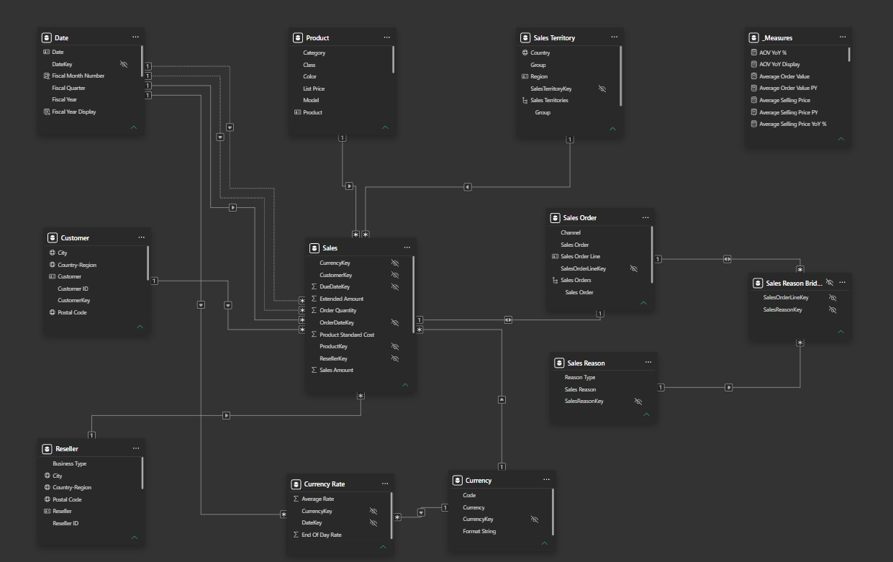

# Sales Performance Dashboard

An interactive **Power BI sales performance dashboard** for analyzing revenue, profitability, product performance, and customer purchasing behavior across different markets.

Built using the **Adventure Works sample dataset** for portfolio demonstration. All results are illustrative and intended to showcase interactive reporting, data modeling, and DAX-based business analysis.

## Dashboard preview

The **Overview** brings together Total Sales, Profit, Profit Margin, Total Orders, and Average Order Value KPIs, with year-over-year comparisons, monthly sales trends, product category performance, and geographic analysis.

## Business objectives

- Monitor Total Sales, Profit, Profit Margin, Total Orders, and Average Order Value.
- Track monthly sales performance and compare key metrics against the previous year.
- Analyze sales and profitability across product categories and geographic markets.
- Identify top-performing products and evaluate their contribution to revenue.
- Understand Internet customer purchasing behavior, repeat purchases, and geographic distribution.

## Report pages

| Page | What it helps analyze |
| --- | --- |
| **Sales Dashboard** | Overall sales performance, profitability, orders, average order value, yearly comparisons, and geographic results. |
| **Products** | Product and category performance, quantity sold, average selling price, and profitability. |
| **Customers** | Internet customer activity, purchase frequency, monthly trends, geographic distribution, and top customers. |

### Products — Product Performance

Analyze product and category contributions to sales, quantities sold, selling prices, and profitability.

### Customers — Customer Analysis

Explore **Internet customer** behavior through total customers, sales per customer, repeat customer rate, one-time versus repeat customer counts, monthly active customer trends, a country map, and a top 10 customer table. Customer KPIs are scoped to Internet sales.

For the purpose and business questions behind each page, see [Report pages and business questions](docs/report-pages.md).

## Technical implementation

- **Power BI Desktop:** Three-page interactive report with KPI measures, time comparisons, and product, customer, and geographic breakdowns.
- **Data modeling:** Central `Sales` fact table connected to `Date`, `Product`, `Customer`, `Reseller`, `Sales Territory`, `Sales Order`, and `Currency`, with separate currency-rate and sales-reason structures.
- **DAX:** Measures for sales, profit, margins, order value, quantity sold, customer activity, and prior-year comparisons.
- **Supporting tables:** `Currency Rate` provides exchange-rate data; `Sales Reason Bridge` connects sales orders with sales reasons. Calculations are organized in `_Measures`.

For a closer look at the model, see [Data model and relationships](docs/data-model.md).

## Key metrics

Total Sales · Profit · Profit Margin % · Total Orders · Average Order Value · Quantity Sold · Average Selling Price · Total Customers · Sales per Customer · Repeat Customer Rate · Year-over-Year %

## Technical documentation

- [Data model and relationships](docs/data-model.md)
- [Selected DAX measures and calculation logic](docs/dax-measures.md)
- [Report pages and business questions](docs/report-pages.md)

## Data and scope

This dashboard uses the **Adventure Works sample dataset** for portfolio purposes. Results are illustrative and should not be interpreted as the financial performance of a real organization.

The Power BI report file is available in the [`powerbi/` folder](powerbi/) and can be opened in Power BI Desktop.
